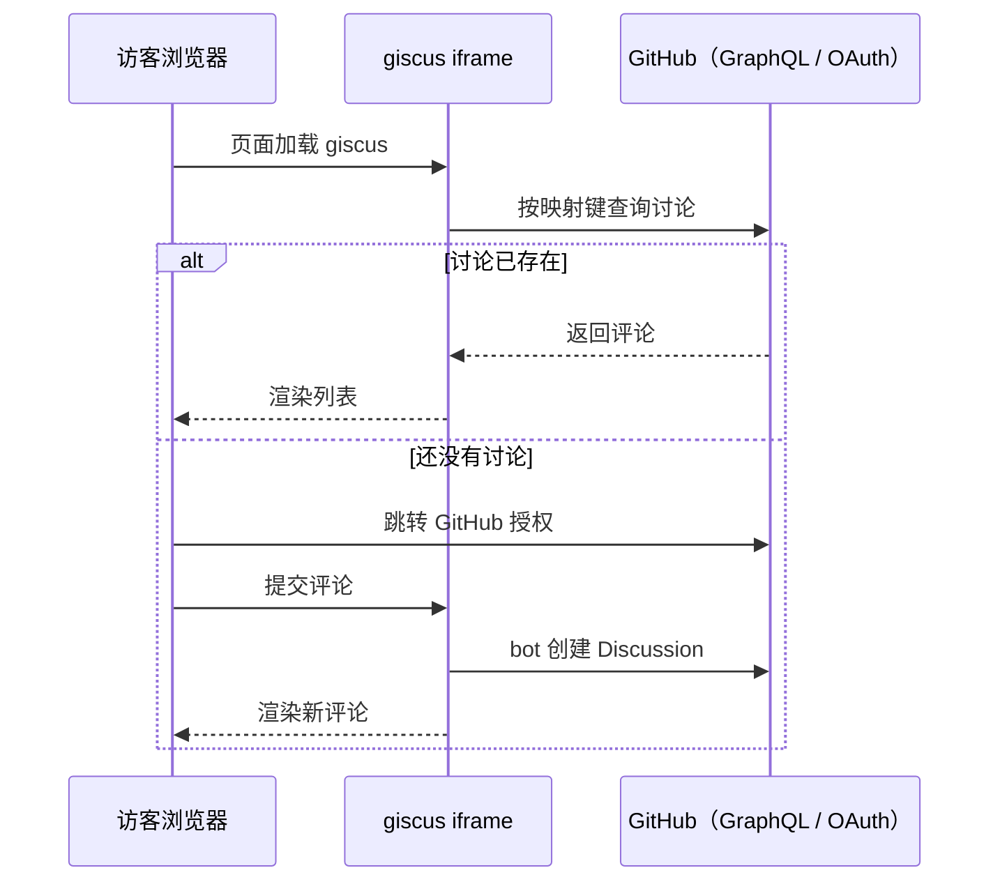

这个站从一开始就定了一个方向：全静态导出，没有 API 路由、没有数据库、没有运行时。理由很实际：托管省钱、没有服务器可被打，而且打算长期写下去，越简单越好。

但评论区绕不过去。评论要存、要登录、要防垃圾，这些活儿传统上都是服务器干的。没有后端，评论从哪来？

最后选了 giscus：评论数据放在仓库的 GitHub Discussions 里，登录交给 GitHub，防滥用交给仓库权限。站点这边，只需要贴一段配置。

## 为什么是它

能选的其实就三类。

| 方案   | 数据存哪           | 要不要服务端            |
| ------ | ------------------ | ----------------------- |
| giscus | GitHub Discussions | 不要                    |
| Waline | 自建数据库         | 要（Serverless 或容器） |
| Twikoo | 自建集合           | 要（云函数或容器）      |

Waline 和 Twikoo 都比 giscus 成熟，功能也多（邮件通知、管理后台、表情包）。但它们都需要额外维护一个后端：数据库、环境变量、冷启动，都是长期成本。

我的目标就是越简单越好，所以这条直接排除：为了一个评论区再引入服务端，等于把刚去掉的服务端加回来。

giscus 的代价是评论者得有 GitHub 账号。技术博客的读者大多有，我能接受。

## 它是怎么工作的

页面上的评论区实际上是一个挂在 giscus.app 下的 iframe。站点里的脚本在评论区的位置把它创建出来，两边用 `postMessage` 通信：主题跟随、高度自适应都走这条通道。

真正干活的是 iframe 里的代码，它和 GitHub 之间全部走官方 API：

几个关键设计：

- 评论就是 Discussions 里的回复，点赞是 GitHub 原生的 reaction。
- 数据在你自己仓库里，随时能导出。giscus 哪天不维护了，评论也还在。这是我选它的第一理由。
- 首次评论会跳 GitHub 授权（授权对象是 giscus 的 OAuth App），token 只存在访客自己的浏览器里，giscus 服务器不保管任何凭证。
- 第一帖由 `giscus[bot]` 创建：安装 App 时它就被授予了讨论读写权限。

## 接入过程

仓库侧三件事：

1. 仓库必须是 public；
2. Settings → General → Features 里勾上 Discussions；
3. 到 giscus App 页面安装，并授权这个仓库。

然后到 giscus.app 逐项配置：

- 映射方式选 `pathname`：匹配键是页面路径，不含域名。文章发布后路径不该再变，本地和线上的路径又一致，两边会指向同一条讨论（下面细说）。
- 分类用一个专门建的 `Blog` 分类，giscus 会把首帖建在这里。如果选的是 Announcements 这类受限分类，也不用站长提前手动开帖：从评论区发首评时，bot 照样能建。
- 其余按需：`strict` 选 0、表情回应开着、输入框放上面、语言 `zh-CN`、主题不要写死，留给组件跟着站点亮暗切换。

配完会生成一段 script，里面有两个自动生成的 id 要原样保存：`data-repo-id` 和 `data-category-id`。

站点这边，官方有两种用法：直接贴原生 script，或者用官方 React 封装 `@giscus/react`。这个站是 Next.js，用了后者，配置全部收在 `site.config.ts` 里：

- 评论区做成可折叠的抽屉，点开才渲染 iframe，评论不占首屏；
- 主题跟着 `html.dark` 走，站点切亮暗，评论区跟着切；
- 留了一个 `enabled` 开关，国内加载实在不行时置 false，整块直接下线，不用回滚代码。

其余参数就是 `strict="0"`、`reactionsEnabled="1"`、`inputPosition="top"`、`lang="zh-CN"`、`loading="lazy"` 这些。

## 两件提前知道的事

### 本地测过的评论，线上也能看到

`pathname` 的匹配键是路径，不含域名。`localhost:3000/posts/hello-world/` 和线上同名的那个路径，路径部分一模一样，所以指向同一条讨论。

我这边的情况是：测试发了一条评论，线上文章里点开评论区就能看到，讨论正文里还带了一条 localhost 的回链。那是 giscus 建帖时记下的来源页面，不影响使用。

如果不希望保留，可以删掉那条讨论，线上首评时会重新创建一条。

### 国内访问要靠运气，所以留了开关

giscus 和 GitHub 在国内的可达性有波动，我没法保证每个访客都能加载出来。

所以评论区留了个总开关，真到加载不了的时候直接关掉就行。评论是纯增量功能，关掉不影响阅读，也不影响站上其他任何部分。

## 现在的状态

上线时间不长，评论区还没什么人来。

但它需要存在——万一有人想回复我呢。
